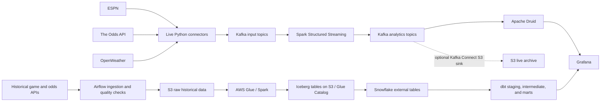
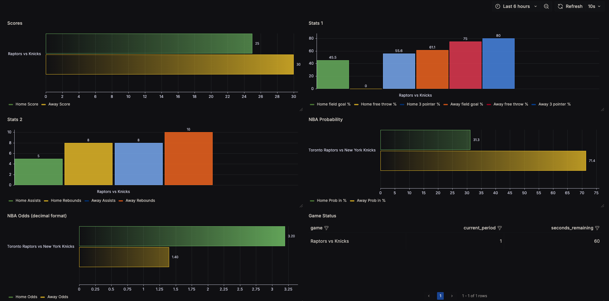

# Betflow: Sports Odds Analytics

Betflow is a Python data engineering project for collecting and analyzing sports games, betting odds, and venue weather. It combines live Kafka and Spark pipelines with historical ingestion, AWS Glue processing, and Snowflake/dbt analytics for the NBA, NFL, NHL, and college football.

The repository contains pipeline code, Airflow DAGs, warehouse SQL, dbt models, Druid ingestion specifications, and Grafana queries. Running the complete platform requires separately configured services and cloud resources.

## Capabilities

- **Live games:** Fetch ESPN scoreboard data and process league-specific game statistics with Spark Structured Streaming.
- **Betting odds:** Collect data from The Odds API and calculate odds ranges, volatility, implied probabilities, and bookmaker comparisons.
- **Venue weather:** Collect OpenWeather data for outdoor NFL and college football games.
- **Historical processing:** Orchestrate game and odds ingestion, data quality checks, and S3 uploads with Airflow; transform historical data with AWS Glue and Apache Iceberg.
- **Warehouse analytics:** Build Snowflake staging, intermediate, and mart models with dbt, including team trends, player leaders, scoring patterns, overtime, market efficiency, and odds movement.
- **Visualization:** Query live analytics through Druid and use the included SQL and screenshots as references for Grafana dashboards.

News connectors and transformation/processing modules are also included, but there is no standalone news pipeline entry point in `src/pipeline_mains/`.

## Architecture



Airflow's `sports_betting_pipeline` controller coordinates the historical path. The live entry points run independently. The diagram includes services that must be provisioned outside the Python package.

## Repository layout

| Path | Purpose |
| --- | --- |
| [`src/betflow/api_connectors/`](src/betflow/api_connectors/) | Game, odds, weather, and news API clients and raw game transformations |
| [`src/betflow/kafka_orch/`](src/betflow/kafka_orch/) | Kafka administration, producers, schemas, retries, and monitoring |
| [`src/betflow/spark_streaming/`](src/betflow/spark_streaming/) | Streaming processors, transformers, configuration, and writer modules |
| [`src/betflow/historical/`](src/betflow/historical/) | Historical connectors, configuration, DAG utilities, and Glue jobs |
| [`src/pipeline_mains/`](src/pipeline_mains/) | Live pipeline launchers and verification scripts |
| [`dags/`](dags/) | Airflow controller, ingestion, processing, and warehouse DAGs |
| [`dbt/`](dbt/) | Snowflake models, macros, source definitions, and data tests |
| [`snowflake/`](snowflake/) | Database, storage integration, external stage/table, and Snowpipe SQL |
| [`src/druid_specs/`](src/druid_specs/) | Kafka ingestion specifications for NBA, NHL, and college football games |
| [`src/grafana_viz_queries/`](src/grafana_viz_queries/) | Dashboard SQL examples |
| [`src/tests/`](src/tests/) | Connector, Kafka, transformer, and processor tests |
| [`setups/`](setups/) | Service installation and deployment notes |
| [`images/`](images/) | Dashboard and infrastructure screenshots |

## Prerequisites

Requirements depend on which pipeline you run:

| Component | Required for |
| --- | --- |
| Python | Package metadata declares Python **3.11+**; CI targets 3.11 |
| Java and Spark | Live streaming; launchers request Spark Kafka connector **3.5.3** for Scala **2.12** |
| Kafka | Live input and analytics topics; launchers use `localhost:9092` |
| API credentials | Live odds, historical odds, and OpenWeather requests |
| AWS credentials, S3, IAM, Glue | Historical ingestion and batch processing |
| Airflow | Historical orchestration; dependency metadata specifies `>=2.10.1` |
| Snowflake and dbt | Warehouse loading and analytical models |
| Druid and Grafana | Live query serving and dashboards |

The deployment notes and paths assume Linux/Ubuntu. Use a Linux environment, such as WSL2 on Windows, for those instructions. The live scripts configure an 8 GB Spark driver, so allow sufficient memory when running multiple pipelines.

## Installation

From the repository root, create and activate a virtual environment:

```bash
python -m venv .venv
source .venv/bin/activate
python -m pip install --upgrade pip
python -m pip install -e .
```

For a native PowerShell environment, activate with `.\.venv\Scripts\Activate.ps1` instead.

Some imported dependencies are missing from `pyproject.toml`. Install these additional libraries for the API clients and pipeline scripts:

```bash
python -m pip install requests python-dotenv aiohttp
```

Installation provides the Python package; it does not provision Kafka, Spark's Java runtime, Airflow, or cloud resources. Dependencies have broad lower bounds and there is no lockfile. The code uses Airflow 2-era APIs, so verify compatibility before upgrading major dependency versions.

### API and AWS configuration

Create a `my.env` file in the repository root with the variables needed by your selected pipelines:

```dotenv
# Live odds launcher
ODDS_FREE_API_KEY=your_live_odds_api_key

# Historical odds ingestion
ODDS_API_KEY=your_historical_odds_api_key

# Outdoor venue weather
OPEN_WEATHER_API_KEY=your_openweather_api_key

# Historical Glue processing
GLUE_ROLE=arn:aws:iam::YOUR_ACCOUNT_ID:role/YOUR_GLUE_ROLE
```

The live odds launcher reads `ODDS_FREE_API_KEY`; the historical odds path reads `ODDS_API_KEY`. Historical API access must be enabled for your credentials. ESPN scoreboard ingestion does not require an API key in the supplied implementation.

The odds launcher searches for `my.env`, while the weather launcher loads it relative to the current directory. Run the individual launchers from the repository root as shown below. Keep credentials out of version control; `my.env` matches the repository's environment-file ignore rule.

For AWS operations, configure credentials through the usual boto3 credential chain, such as an AWS profile or instance role. The code contains `us-east-1` defaults and deployment-specific resource names that must be adapted before use.

## Run live pipelines

Start Kafka first and make the input and output topics available. Each command below runs a long-lived pipeline; use a separate terminal for each, with the virtual environment activated and the repository root as the working directory.

```bash
python src/pipeline_mains/games_pipeline.py
```

```bash
python src/pipeline_mains/odds_pipeline.py
```

```bash
python src/pipeline_mains/weather_pipeline.py
```

| Pipeline | Leagues | Kafka input | Kafka output |
| --- | --- | --- | --- |
| Games | `nba`, `nfl`, `nhl`, `cfb` | `<league>.game.live` | `<league>_games_analytics` |
| Odds | `nba`, `nfl`, `nhl`, `cfb` | `<league>.odds.live` | `<league>_odds_analytics` |
| Weather | `nfl`, `cfb` | `<league>.weather.current` | `<league>_weather_analytics` |

College football uses `college-football` for ESPN requests, `americanfootball_ncaaf` for The Odds API, and `cfb` in topic names. The generic `sports.*` topics in `create_default_topics()` differ from the league-specific topics used by these launchers.

The games loop polls approximately every minute. Odds polling varies from 10 to 30 minutes based on game timing. Weather polling occurs approximately every 15 minutes for eligible outdoor venues. Pipelines can return or stop when no relevant games are available; missing weather for indoor games is expected.

**Checkpoint behavior:** All three launchers delete their respective `/tmp/checkpoint/games`, `/tmp/checkpoint/odds`, or `/tmp/checkpoint/weather` directory when started. Change that behavior before relying on persistent state or restart recovery.

An additional `main_pipeline.py` supervisor launches all three scripts using relative filenames. It expects `src/pipeline_mains/` as its working directory; ensure weather credentials are available there or exported into its environment. The individual commands above are easier to configure independently.

To inspect an output topic, run Kafka's consumer from your Kafka installation:

```bash
bin/kafka-console-consumer.sh --bootstrap-server localhost:9092 \
  --topic nba_games_analytics --from-beginning
```

Configure Druid ingestion using the [included specifications](src/druid_specs/) and the [Druid setup notes](setups/druid.md). Specifications are supplied for NBA, NHL, and college football game analytics; additional streams need corresponding ingestion configuration. Grafana queries are in [`src/grafana_viz_queries/`](src/grafana_viz_queries/).

## Historical pipelines and warehouse setup

1. Configure the raw and processed S3 buckets, Glue Data Catalog, IAM role, and AWS access. Update bucket names and date ranges in [`historical_config.py`](src/betflow/historical/config/historical_config.py) and [`processing_config.py`](src/betflow/historical/config/processing_config.py). Update the absolute Glue script paths in `ProcessingConfig.SCRIPT_PATHS` to your checkout location.
2. Install Betflow in the Airflow execution environment and deploy the files in `dags/` to its DAG directory. The warehouse DAG also requires `astronomer-cosmos` and `apache-airflow-providers-snowflake`, which are not declared in the package metadata. Choose versions compatible with your Airflow installation and the operators imported by the DAGs.
3. Set the Airflow variable `LOGS_BUCKET` to your Glue script/log bucket and configure the `snowflake_conn` connection. Provide `GLUE_ROLE` and historical odds credentials to the task environment.
4. Configure Snowflake using the [setup guide](setups/snowflake.md) and [SQL scripts](snowflake/). Adapt account-specific integration details, S3 paths, and permissions; create the database, storage integration, stages/file format, and external tables before running warehouse transformations.
5. Configure dbt as described below. Update the absolute project and profile paths in [`snowflake_dbt_staging_marts.py`](dags/snowflake_dbt_staging_marts.py).
6. Review dates and catchup settings, then enable or manually trigger `sports_betting_pipeline` in Airflow.

The controller runs this dependency chain:

```text
sports_ingestion_dqc ──┬──> sports_batch_processing ──┐
                      └──> odds_ingestion_dqc        ├──> snowflake_dbt_staging_marts
                                └──> odds_batch_processing ──┘
```

Game ingestion supplies the game data used by odds ingestion. Batch jobs process historical JSON into Iceberg tables on S3. The warehouse DAG waits for both batch DAGs, refreshes Snowflake external tables, and runs selected dbt models with their dependencies through Cosmos.

The parent DAG is scheduled daily, starts on **December 9, 2024**, and enables catchup. The warehouse DAG starts on **December 16, 2024**. Align these dates and choose the intended backfill range before enabling the controller. Configuration files also contain fixed 2024 date ranges.

See [`dags/README.md`](dags/README.md) for additional pipeline diagrams.

### dbt

The dbt project lives in `dbt/` and uses a profile named `betflow`. Install its separate requirements in an appropriate dbt environment:

```bash
python -m pip install -r dbt/dbt-requirements.txt
```

The requirements file pins a dbt Core prerelease and a Snowflake adapter version; validate their compatibility in your environment. Create `~/.dbt/profiles.yml` with a `betflow` profile and `dev` target, supplying your Snowflake account, authentication, role, warehouse, database, and base schema. See the [profile example](setups/dbt.md), and use `SPORTS_DB` unless you also update the source definitions and SQL.

From the repository root:

```bash
cd dbt
dbt deps
dbt debug
dbt build
```

The models are organized into three layers:

- `models/staging/`: Normalize games and odds for all four leagues.
- `models/int/`: Derive game statistics, leaders, team performance, bookmaker comparisons, odds movement, and market efficiency.
- `models/marts/`: Publish core dimensions/facts and analytical facts, including betting value, scoring patterns, team trends, record matchups, and overtime analysis.

The project configures incremental materializations and schema suffixes `staging`, `int_layer`, `mart_core`, and `mart_analytics`. Source definitions reference external tables in `SPORTS_DB.RAW_LAYER`. dbt tests include schema checks and custom SQL checks for odds, market metrics, records, leaders, and scoring periods.

## Development and testing

Install test tools separately:

```bash
python -m pip install pytest pytest-asyncio pytest-cov mockafka-py
python -m pytest src/tests -v
```

Tests cover API connectors, Kafka configuration and handlers, and Spark transformations/processors. Spark tests require Java and may download Maven artifacts. Some tests reference an older interface, including `GamesProcessor`, which is no longer exported by the processor package. The shared fixture file is named `conftests.py`, so pytest does not automatically discover it as `conftest.py`. Expect these issues to need repair before treating a full test run as a passing baseline.

GitHub Actions includes pytest, Ruff, and mypy workflows. The pytest workflow currently installs a root `requirements.txt` that is absent from this checkout. Terraform workflows also reference a `terraform/` directory that is not included. These workflows need updates before they can validate or provision this checkout reliably.

## Deployment notes and limitations

- Kafka addresses, Spark ports, checkpoint locations, AWS regions, bucket names, and `/home/ubuntu/...` paths are embedded in several files. Review them for your environment.
- The Dockerfile uses an Astronomer runtime, copies `my.env` into the image, and clones the original upstream repository's `dev` branch. It does not build the current local checkout or provide the complete service stack. Adapt it before deployment and supply credentials at runtime.
- Both `kafka-python` and `kafka-python-ng` are declared dependencies and provide the `kafka` namespace. Resolve the intended client distribution if installation or import conflicts occur.
- Python support is declared as 3.11+, but some Glue utilities use nested same-quote f-string expressions that require Python 3.12 syntax. Review those expressions when targeting Python 3.11 or the configured Glue 4.0 runtime.
- News sentiment, weather impact warehouse models, and predictive modeling are mentioned in older documentation; the checked-in dbt models focus on games and odds. Consult the actual model files for implemented analytics.

## Documentation and screenshots

- [Infrastructure overview](setups/README.md)
- [Kafka and S3 sink](setups/kafka.md)
- [Airflow](setups/airflow.md)
- [Druid](setups/druid.md)
- [Snowflake](setups/snowflake.md) and [additional SQL setup notes](snowflake/setup.md)
- [dbt setup](setups/dbt.md) and [model overview](dbt/README.md)
- [Grafana](setups/grafana.md)
- [Demo screenshots](demo.md)
- [Earlier usage notes](usage.md)

The setup documents contain deployment-specific examples; use the current source files for exact paths, topic names, and environment variable names.



Additional NFL, NHL, Druid, and Airflow screenshots are available in [the demo](demo.md).

## License

Licensed under the [MIT License](LICENSE). Copyright (c) 2024 Sanchit Vijay.
